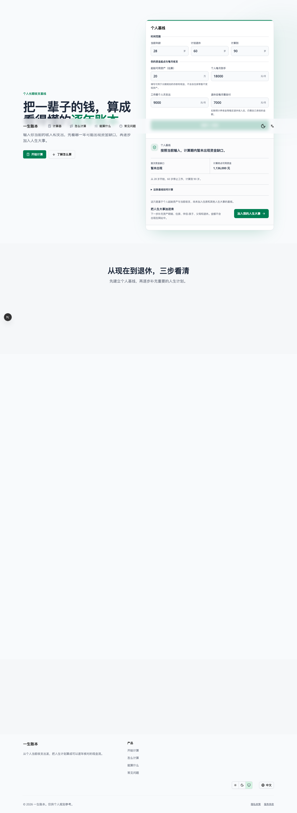

# 一生账本 P2.1 阶段 1 执行记录

> 阶段：Landing 个人基线  
> 完成日期：2026-10-14  
> 状态：完成

## 1. 执行结果

Landing 已从旧的双模式退休估算器重构为单一的个人长期收支基线。用户填写 7 项个人数据，就能得到由 P1 确定性月度计算内核生成的首次资金缺口和计算终点可用资金，并可把同一份正式计划交给工作台继续完善。

```text
当前年龄 + 起始可用资产（万） + 个人月收入 + 工作期个人月支出 + 退休后每月需自付 + 退休年龄 + 计算末年
  → 建立只有 self 的 LifePlan
  → safeCalculateMonthlyLifePlan
  → 展示结论、关键数字和计算口径
  → sessionStorage v2 handoff
  → /plan
```

页面不接收家庭结构、伴侣、孩子、父母、非流动资产、债务或养老金政策；退休后每月需自付作为独立输入保留。起始可用资产只表示可用于长期规划的存款和现金，页面不显示汇率、Agent 或未完成的 AI 入口。

## 2. 正式计算合同

新增纯函数 `createPersonalBaselinePlan()`，映射规则如下：

| 项目           | 阶段 1 规则                              |
| -------------- | ---------------------------------------- |
| 成员           | 只创建 `self`                            |
| 起始可用资金   | 用户以“万”为单位估算，提交后换算为整数分 |
| 工作期收入     | 当前个人月收入，退休月停止               |
| 工作期支出     | 当前个人月支出，退休月停止               |
| 退休期收入     | 0 元                                     |
| 退休期支出     | 用户填写的退休后每月需自付               |
| 金额口径       | 当前购买力                               |
| 实际增长与收益 | 0%                                       |

表单组件只负责解析、校验和展示。正式金额只读取 `safeCalculateMonthlyLifePlan()` 的结果，没有新增第二套金额公式。

## 3. UI 与用户行动轨迹

### 输入前

- 首屏明确告诉用户这是“个人长期收支基线”。
- 表单按“时间范围”和“资金起点与每月收支”分组，并解释起始资产范围和退休后需自付的扣除口径。
- 当前购买力作为计算口径提示，不显示固定年份汇率。

### 计算后

- 先给出一句确定性结论：无缺口、持续缺口或中途缺口后恢复。
- 直接展示首次资金缺口和计算终点可用资金；删除在这组简化输入下信息价值较低的“最低可用资金”。
- 说明退休后收入按 0、支出使用填写的每月需自付金额，并从用户估算的起始可用资产开始。
- 告知用户当前收获只是个人基线，下一步可加入住房、伴侣-孩子、父母和退休。

输入修改后，旧结果会保留用于对照，但“加入我的人生大事”会禁用，直到重新计算，防止旧结果与新输入混用。

## 4. 代码变更

- 新增 `landing/personal-baseline.ts`：七字段合同、字符串草稿校验、万元到整数元的显式换算和正式计划工厂。
- 新增 `landing/personal-baseline-form.tsx`：七字段表单、字段错误、计算和 v2 交接。
- 新增 `landing/personal-baseline-result.tsx`：确定性结论、两项关键数字、假设和下一步行动。
- 新增 `landing/personal-baseline.test.ts`：输入、边界、正式计划、月度结果和工作台交接回归。
- 重构 `themes/default/blocks/hero.tsx`，删除旧年度模型和模式切换，保留起始可用资产与独立的退休后每月需自付。
- 更新中英文首页、SEO 和页脚文案，统一为个人基线语义。
- 将 `landing/*.test.ts` 纳入 `test:calculation`。

## 5. 验证结果

```text
npm run test:calculation
46 passed, 0 failed

node_modules/.bin/tsc --noEmit
passed

npm run build
passed
```

额外检查：

- 中英文 calculator key 和 7 个字段 key 完全一致。
- Landing 代码不再引用 `safeCalculateLifePlan` 或模式切换。
- 真实 375px 设备视口的 `innerWidth` 与页面 `scrollWidth` 均为 375，没有横向溢出。
- 默认输入可正常计算并滚动到结果，结果由正式计划的输入哈希关联。

生产构建只有既有的 `baseline-browser-mapping` 数据过期提示，不影响构建结果。项目仍缺少 ESLint 9 所需的 `eslint.config.*`，因此本阶段无法运行 lint；这是阶段 0 已记录的工具配置缺口。

## 6. 视觉验收

桌面 1440px：



移动端 375px：


移动端退休自付输入：


移动端计算结果：


## 7. 兼容性与阶段出口

- 不修改 IndexedDB 中的既有正式计划，也不需要本地数据迁移。
- 继续使用原有 v2 handoff；金额不会进入 URL。
- 测试证明 Landing 结果与读取 handoff 后的工作台输入产生相同哈希、摘要和年度结果。
- 无网络、无 AI 配置时可以完成输入、计算、解释和交接。

阶段 2 可以在该个人输入合同上开始拆分工作台状态层和“概览 / 规划 / 年度账本”三视图骨架。
