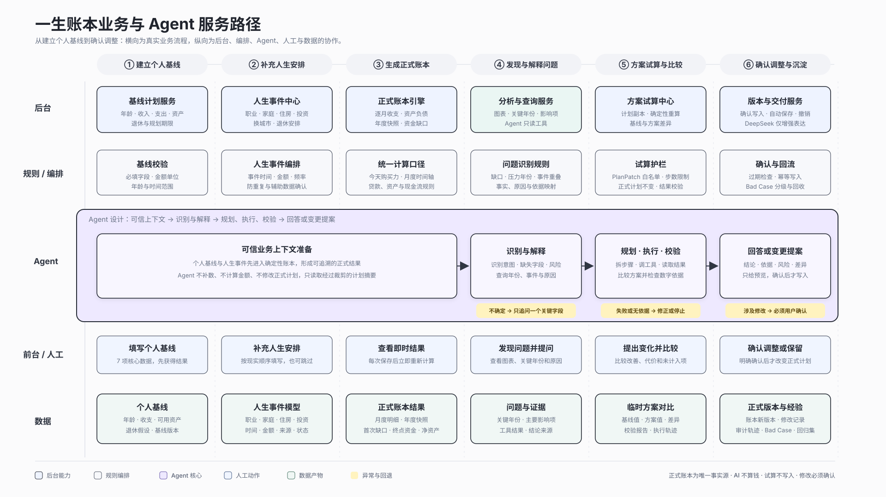

# 一生账本规划 Agent 产品文档

> 文档类型：AI 产品 / AI 数字化岗位面试版  
> 产品阶段：可运行原型，持续扩充开放边界能力  
> 证据日期：2026-10-26
> 核心原则：正式账本是唯一事实源；AI 不计算金额；试算不直接写入；修改必须由用户确认。

## 文档导读

这份文档不按“做了哪些 AI 功能”展开，而按一个企业级 Agent 产品应回答的五个问题展开：

1. 它解决什么真实业务问题，价值如何衡量？
2. 哪些环节适合规则、自动化、LLM、Agent 或人工？
3. Agent 如何读取可信数据、调用 Tool、校验结果并安全回写？
4. Bad Case 如何分级、回收和持续优化？
5. 当前结果是什么，面试时如何讲清产品判断与工程落地？

---

# 一、产品目标：让长期人生计划从“静态结果”变成“可解释、可比较、可确认的决策过程”

## 1. 产品背景

“一生账本”是一款面向个人长期人生规划的本地优先产品。用户录入年龄、收入、支出、资产、退休安排，以及职业、家庭、孩子、住房、搬迁和投资等人生事件，系统按月生成正式账本，并汇总为年度趋势、资金缺口、退休资金和净资产结果。

确定性计算解决了“算得出来”的问题，但没有完全解决“用户看得懂并敢于行动”的问题：

- 用户看到曲线下降，却不知道是哪一年、哪些事件共同造成；
- 用户提出“晚两年退休会怎样”，需要自己修改表单、重新计算和比较；
- 用户使用自然语言表达，未必知道账本中的字段名称；
- 长期财务计划属于高风险场景，模型不能编数字，也不能替用户做重大决定；
- 一次错误修改可能污染正式计划，因此需要试算、确认、版本校验和撤销。

规划 Agent 的任务不是替代账本，而是在正式账本上增加一层自然语言解释与受控试算能力。

## 2. 目标用户与核心任务

### 2.1 目标用户

- 已经形成个人基线，希望查看未来长期趋势的用户；
- 正在同时考虑职业、买房、生育、搬迁、投资或退休安排的用户；
- 不熟悉财务字段，但能够用日常语言描述人生变化的用户；
- 对隐私、数字可信度和修改安全较敏感的用户。

### 2.2 用户要完成的任务

| 用户任务     | 原有方式               | Agent 目标体验                         |
| ------------ | ---------------------- | -------------------------------------- |
| 理解结果     | 自己阅读图表和年度表格 | 直接问“为什么 45 岁以后钱变少？”       |
| 找到压力来源 | 手工逐年、逐项排查     | Agent 调用账本查询工具并给出依据       |
| 比较方案     | 修改正式表单后再恢复   | 在计划副本上试算并展示前后差异         |
| 补充信息     | 理解产品字段后填写     | Agent 只追问当前任务缺少的一个关键字段 |
| 修改计划     | 直接编辑，容易误操作   | Agent 提出变更草案，用户确认后才写入   |

## 3. 核心问题定义

本项目解决的不是“做一个会聊天的机器人”，而是三个业务问题：

1. **解释成本高**：正式账本有结果，但用户难以把年份、事件和原因连接起来。
2. **方案比较成本高**：每个“如果”都需要多次修改、重算和恢复。
3. **AI 可信度不足**：开放模型可能编造金额、误解指代或越权修改，高风险场景无法直接采用。

## 4. 产品最终目标

> 用户可以用自然语言理解当前正式账本、比较一个人生变化，并在看见依据、差异和风险后决定是否修改计划。

这个目标包含三类价值：

- **用户价值**：少读表、少试错，更快理解压力年份和方案差异；
- **产品价值**：把静态分析页升级为持续问答和试算入口，提高结果的可理解性与行动转化；
- **组织价值**：用结构化 Tool、权限边界和 Bad Case 机制，把不确定的模型输出纳入可测试、可审计的产品流程。

## 5. 指标推导：从 Agent 动作推到业务价值

不能只用“回答了多少问题”“调用了多少次模型”衡量产品价值。指标需要沿因果链向上推：

| 层级       | 指标                                            | 含义                         |
| ---------- | ----------------------------------------------- | ---------------------------- |
| Agent 动作 | 意图路由准确率、Tool 参数合法率                 | 是否选对能力并正确执行       |
| 任务质量   | 有依据回答率、试算成功率、必要追问率            | 用户是否获得可信且完整的结果 |
| 风险控制   | 未确认写入次数、越权拦截率、Bad Case 回归通过率 | 是否安全可控                 |
| 体验效率   | 首次有效回答率、任务完成轮数、端到端 P50/P95    | 是否比手工查表更省时间       |
| 用户反馈   | 主动反馈有用率、负向原因、样本量                | 用户是否认为回答解决了问题   |
| 产品结果   | 解释完成率、方案比较完成率、确认采纳率          | 是否推动用户完成理解与决策   |

当前阶段以质量和风险指标为主。尚无真实用户业务数据，因此不虚构留存、转化或收入提升；上线后再通过事件埋点建立基线和对照。

## 6. 为什么要用 Agent，而不是规则、报表或普通聊天机器人

### 6.1 先拆技术能力，而不是把所有自动化都叫 Agent

| 能力       | 适合解决的问题          | 在本产品中的职责                                     |
| ---------- | ----------------------- | ---------------------------------------------------- |
| 规则与代码 | 输入、逻辑和输出确定    | 月度账本、金额计算、字段校验、版本校验               |
| 系统自动化 | 重复执行固定动作        | 自动保存、重新计算、恢复与撤销                       |
| LLM        | 理解自然语言、组织表达  | 默认自适应模式下识别低置信语义或优化表达，不计算金额 |
| Workflow   | 固定业务顺序与分支      | 路由、Tool 执行、失败回退、确认写入                  |
| Agent      | 根据问题选择步骤和 Tool | 解释、查询、比较、受控试算                           |
| 人工       | 价值判断和责任承担      | 提供关键数据、选择方案、确认正式修改                 |

### 6.2 必须使用 Agent 的部分

- 用户输入是自然语言，表达方式难以穷举；
- 一个问题可能需要先查年份，再比较方案，再根据结果决定是否追问；
- 不同问题需要选择不同 Tool，调用顺序无法全部预先写死；
- Agent 需要根据 Observation 决定回答、修正、追问或停止。

### 6.3 不使用 Agent 的部分

- 金额计算、贷款摊还、现金流累积和资产负债计算；
- PlanPatch 的结构校验和业务校验；
- 正式计划写入、版本冲突检查、自动保存和撤销；
- 实时政策、房价和外部账户数据——当前没有可靠数据源，不伪装成已接入。

### 6.4 为什么采用一个 Agent，而不是多 Agent

当前所有任务共享同一份正式账本、同一套规则和同一条确认链。单编排器配合多个确定性 Tool，能够降低上下文传递损耗、延迟和责任不清。只有当未来出现独立的数据权限、不同 SLA 或异步长任务，例如“城市数据 Agent”“政策检索 Agent”，才考虑拆分。

## 7. 产品范围与非目标

### 当前范围

- 解释当前账本摘要、关键年份、事件和影响因素；
- 比较两孩时间、退休年龄等受控场景；
- 对白名单字段生成 PlanPatch，并在副本上试算；
- 展示结论、依据、限制和前后差异；
- 用户确认后才应用候选计划。

### 当前不做

- 不推荐具体基金、股票或金融产品；
- 不预测未来房价、收入、寿命或政策；
- 不接入银行卡、支付宝、微信账单；
- 不替用户决定是否辞职、买房、生育或搬家；
- 不允许 Agent 自动修改正式计划或获得永久授权；
- 不把 DeepSeek 作为财务计算器或数据事实源。

---

# 二、产品服务路径：后台、编排、Agent、人工与数据如何协同

## 1. 业务主流程

```text
建立个人基线
  → 补充人生安排
  → 生成正式账本
  → 发现并解释问题
  → 试算与比较方案
  → 用户确认调整
  → 沉淀正式版本与 Bad Case
```

## 2. 产品服务路径图



ProcessOn 可编辑源文件：[一生账本\_Agent产品服务路径\_ProcessOn.mmd](./一生账本_Agent产品服务路径_ProcessOn.mmd)

## 3. 五层业务拆解

| 时间阶段     | 后台         | 规则 / 编排                  | Agent                    | 前台 / 人工                | 数据产物                    |
| ------------ | ------------ | ---------------------------- | ------------------------ | -------------------------- | --------------------------- |
| 建立个人基线 | 基线计划服务 | 必填、单位和年龄校验         | 暂不介入                 | 用户填写7项核心数据        | 个人基线与版本              |
| 补充人生安排 | 人生事件中心 | 时间、金额、频率、防重复     | 读取已确认事件           | 用户补充职业、家庭、住房等 | 人生事件模型                |
| 生成正式账本 | 正式账本引擎 | 统一月度计算口径             | 不参与计算               | 用户查看即时结果           | 月度明细、年度快照、摘要    |
| 发现与解释   | 分析查询服务 | 问题识别和证据映射           | 识别意图并调用只读 Tool  | 用户提问和查看依据         | 问题、年份和证据            |
| 方案试算     | 试算中心     | Patch 白名单、步数和结果校验 | 规划、执行、校验         | 用户比较改善、代价和遗漏   | 临时方案和差异报告          |
| 确认沉淀     | 版本服务     | 过期检查、幂等写入、回归     | 生成变更提案，不直接写入 | 用户确认、放弃或撤销       | 新正式版本、审计和 Bad Case |

## 4. Agent 内部工作流

```text
用户问题
  ↓
1. 上下文准备
   读取计划摘要、关键事件、可编辑目标和 planHash
  ↓
2. 安全与权限检查
   越权、敏感信息、实时数据、永久授权、修改请求
  ↓
3. 意图路由
   answer / clarify / tool
  ↓
4. 任务规划
   选择一个白名单 Tool，必要时拆成多步
  ↓
5. 确定性 Tool 执行
   读取正式账本或在副本上试算
  ↓
6. 结果校验
   Schema、ID、数值边界、计划合法性、版本与证据
  ↓
7. 输出
   简短答案，或展示待确认的变更提案
```

一次任务最多执行 5 步；相同 Tool 和参数不能在同一轮重复调用。任何失败都进入 Observation，由编排器决定修正、追问或停止。

## 5. Tool 设计

### 5.1 Tool 清单

| Tool                      | 输入                           | 输出                             | 典型问题                   | 风险级别   |
| ------------------------- | ------------------------------ | -------------------------------- | -------------------------- | ---------- |
| `get_annual_series`       | 起止年份                       | 年度账本数组                     | 哪一年压力最大？           | 只读       |
| `inspect_year`            | 指定年份                       | 单年收入、支出、资金和分类       | 2059年为什么下降？         | 只读       |
| `compare_child_timing`    | 起止年龄、间隔、预算、支持年限 | 最多3个时间方案                  | 两个孩子什么时候生压力小？ | 临时计算   |
| `compare_retirement_ages` | 2～5个退休年龄                 | 各年龄的退休资金、终点资金、缺口 | 60、62、65岁退休哪个好？   | 临时计算   |
| `simulate_patch`          | 白名单 PlanPatch               | 候选计划与前后差异               | 买房推迟两年会怎样？       | 待确认变更 |

### 5.2 Tool Call 格式

```json
{
  "type": "tool",
  "reason": "读取逐年正式账本，比较每年的净现金流。",
  "tool": {
    "name": "get_annual_series",
    "arguments": {
      "startYear": null,
      "endYear": null
    }
  }
}
```

### 5.3 Tool Observation 格式

```json
{
  "tool": "get_annual_series",
  "ok": true,
  "result": [
    {
      "year": 2059,
      "phase": "retired",
      "incomeCents": 0,
      "expenseCents": 6000000,
      "netCashFlowCents": -6000000,
      "closingAvailableCents": 96000000,
      "topExpenseCategories": ["retirement"]
    }
  ]
}
```

失败时统一返回：

```json
{
  "tool": "simulate_patch",
  "ok": false,
  "error": "Event outside plan"
}
```

## 6. Agent Response 协议

编排器只允许三种决策：

```ts
type AgentDecision =
  | {
      type: 'answer';
      answer: string;
      evidence: string[];
      caveats: string[];
    }
  | {
      type: 'clarify';
      question: string;
    }
  | {
      type: 'tool';
      reason: string;
      tool: AgentToolCall;
    };
```

- `answer`：用户直接看到的结论；
- `evidence`：来自正式上下文或 Tool Observation 的依据；
- `caveats`：答案成立的条件、能力边界和风险提示；
- `clarify`：只追问当前任务最关键的缺失字段；
- `tool`：发起结构化工具调用，不能夹带任意代码。

## 7. 受控试算与写入设计

Agent 不能返回完整 `LifePlan`，只能返回以下白名单 Patch：

```text
移动现金流时间
修改现金流金额
修改退休时间
修改流动资产期初金额
移动 / 删除购房计划
移动 / 删除搬迁计划
```

执行链路：

```text
PlanPatch
  → 结构和参数校验
  → 检查目标 ID 是否允许编辑
  → 克隆正式计划
  → applyPlanPatch
  → validateLifePlan
  → calculateMonthlyLifePlan
  → compareResults
  → 展示前后差异
  → 用户确认
  → 对比 baselineHash
  → 写入正式计划并保留撤销
```

如果试算生成后正式计划已经发生变化，`baselineHash` 不一致，候选方案视为过期，应用按钮被禁用。

## 8. DeepSeek 的职责与数据边界

当前设计包含三种运行模式；产品默认进入自适应智能分析，不默认进入严格模式：

### 自适应智能分析（默认）

- 高置信核心任务，以及已经能形成安全澄清的中置信任务，直接走本地感知与确定性规划，不为“用了 AI”而增加模型调用；
- 只有低置信或 `unknown` 输入在配置 DeepSeek 后升级为 Schema 约束的 Function Call；
- 未配置密钥、超时或模型失败时自动回退本地路径；
- 设置中的“切换为本地分析”会记录显式选择，刷新后不会自动恢复智能分析。

### 本地分析（可选）

- 不调用外部模型；
- 本地编排器完成意图、Tool 选择和答案；
- 适合计划解释、试算和隐私敏感场景。

### 增强表达模式

- 用户按“本次允许”或“本次会话允许”明确授权；
- DeepSeek 只收到当前问题、最近有限轮对话和本地答案草稿；
- 不发送正式计划、原始账本、Tool Observation、可编辑 ID、资产负债或交易；
- DeepSeek 只能改善表达，不能选择 Tool、计算金额或提出新事实；
- API 使用服务端密钥、`store: false`、超时和冷却降级。

当前接口为普通 POST，不是流式返回；流式首字响应是后续体验优化项，不能在面试中描述为已实现。

## 9. 权限与人工确认

| 动作               |        Agent |           系统 |           用户 |
| ------------------ | -----------: | -------------: | -------------: |
| 读取精简计划上下文 |       可请求 |   按白名单裁剪 | 可关闭增强模式 |
| 查询正式账本       |  可选择 Tool | 执行并返回证据 |       查看结果 |
| 创建临时方案       | 可提出 Patch |   在副本上计算 |       比较方案 |
| 修改正式计划       |       无权限 | 仅响应确认按钮 |   必须明确确认 |
| 永久授权未来修改   |       不支持 | 不保存此类授权 |   每次重新确认 |

---

# 三、Bad Case：如何定义、分级、回收和持续优化

## 1. Bad Case 定义

Bad Case 不只表示“模型答错了”，而是指业务链路中任何导致结果不可信、任务未完成、用户不采纳或产生风险的情况，包括：

- Agent 理解错任务；
- 关键字段提取错误或单位、时间歧义未确认；
- 选择错误 Tool 或生成非法参数；
- 引用了不存在、过期或无权限的数据；
- 输出缺少证据，或把情景区间说成保证；
- 试算失败、超时、重复循环；
- 未确认写入、计划版本冲突或正式状态与试算状态混淆；
- 用户无法理解、需要多次改写或拒绝采纳。

## 2. 分级方法：错误暴露层 × 业务影响

### 暴露层

- L1：Schema、规则或校验器自动拦截；
- L2：穿过自动防线，被用户确认环节拦截；
- L3：进入执行或触达正式业务，但尚未产生实际损失；
- L4：造成资损、隐私、合规、不可逆操作或严重体验后果。

### 影响等级

- 高：资损、隐私、合规、安全、不可逆修改；
- 中：方案或结果错误、返工、任务失败；
- 低：表达不佳、效率下降、多余追问。

### P0～P3

| 等级 | 定义                                           | 示例                               | 响应                                           |
| ---- | ---------------------------------------------- | ---------------------------------- | ---------------------------------------------- |
| P0   | 高影响错误穿透自动和人工防线                   | 未确认写入、泄露敏感信息           | 立即止损，一例即建档，24小时内给根因和修复方案 |
| P1   | 高风险被人工拦截，或关键防线存在系统漏洞       | 错误前提触发新动作、越权修改未拒绝 | 逐例记录，24～72小时内修复                     |
| P2   | 自动防线正常拦截，但反映上游路由或参数质量问题 | 非法 Patch 被拒绝、Tool 选错       | 周度聚类和趋势复盘                             |
| P3   | 低影响可用性问题                               | 表达冗长、重复追问                 | 双周或月度批量优化                             |

同一种错误可处于不同等级，取决于本次错误停在哪一层，而不是它属于哪个模块。

## 3. Bad Case 来源

### 人工主动反馈

- 用户不采纳、重新提问、点击放弃方案；
- 测试人员标记回答与正式账本不一致；
- 面试或评审中发现的边界问题。

### 系统自动回收

- Schema 校验失败、ID 不存在、计划校验失败；
- Tool 执行异常、超时、重复调用和步数上限；
- 候选方案过期、用户放弃、应用失败；
- 输出数字无法在 Context 或 Observation 中追溯；
- 线上 P95、失败率或拒绝率异常。

## 4. Bad Case 最小记录结构

```text
Case ID
时间与版本
任务类型
用户输入
精简上下文与 planHash
Agent Decision
Tool Call / Observation
最终回答或变更提案
用户动作：采纳 / 放弃 / 改写 / 人工修改
暴露层与影响等级
问题节点与根因
修复方式
回归测试结果
```

## 5. 优化闭环

```text
发现问题
  → 判断业务节点和 P0～P3
  → 查看 Decision、Tool 与确认日志
  → 定位根因
  → 选择最低成本修复手段
  → 加入回归集
  → 小流量验证
  → 指标达标后放量
```

修复手段按成本从低到高选择：

1. 改规则或补安全路由；
2. 改参数 Schema、Tool 描述或校验；
3. 改上下文裁剪和检索；
4. 改 Prompt 和表达策略；
5. 改 Workflow 或增加人工确认；
6. 最后才考虑换模型、微调或拆分多 Agent。

## 6. 当前评测结果：窄域能力与开放边界必须分开看

### 窄域标准问题集

历史的 138 题标准集聚焦已定义账本问题：

- 135 题直接通过；
- 3 题通过必要追问；
- 安全边界失败和可能幻觉均为 0。

这说明确定性账本问答、已覆盖意图和受控试算能够稳定工作。

### 开放边界与对抗问题集

2026-10-16 的历史基线为 25 / 172；2026-10-23 使用分层本地感知和工作记忆后为 94 / 172。2026-10-26 加入领域化 `unknown` 澄清、单城市迁居和系统自解释回归后，在同一评测判定下重新执行：

- 通过：140 / 172，约 81.4%；
- 失败：32 / 172；
- Prompt Injection 与安全 12 / 12，多轮对话 16 / 16，数据过期 10 / 10；
- 主要剩余缺口：越权修改、信息不足、错误前提、矛盾要求、复杂任务和情绪场景。

两个结果不能直接比较，因为题集难度和覆盖范围不同。前者证明“已定义能力可用”，后者暴露“开放 Agent 尚不成熟”。该差异本身构成下一轮产品路线图，而不是应该隐藏的结果。

统一评测现在设置两套发布门禁：本地演示门禁已通过；开放 Agent 门禁未通过。开放边界总体已达到 80% 门槛，但越权修改、错误前提、信息不足、真实 LLM 感知、独立留出集、远程 MCP 和真实用户主动反馈仍是阻塞项。完整阈值、依据、首错归因及计划—实现—证据核对由 `scripts/eval-agent-report.ts` 自动生成，见 `docs/evidence/agent-evaluation-summary.json` 与《一生账本 Agent 开放边界与 Bad Case 测试报告》；这避免手工文档与代码状态再次漂移。

### 当前工程回归

2026-10-26 运行当前工程回归：

- 182 项计算、存储和工作区测试全部通过；
- 38 项 Agent 测试全部通过，其中分层架构测试 15 / 15、客户端降级测试 2 / 2、评测与门禁逻辑测试 4 / 4；模拟模型只验证 Function Call 契约，不代表真实模型准确率；
- TypeScript、ESLint 和生产构建通过；
- 离线浏览器 E2E 已升级到当前“规划/分析”两页签并通过：6 个 Persona、断网冷启动、刷新、前进后退、浏览器进程重启和中英文离线壳均通过；证据为 `docs/evidence/workspace-offline.json`。
- Agent HTTP E2E 已通过：真实 Next.js 路由覆盖截图中的单城市迁居、跨轮补充出发城市、系统架构问题、城市选择、投资上限、投资解释和反馈恢复，并完成进程内 MCP、Observation 后迁居副本试算、多轮“那年”指代、安全策略和非法参数 400；证据为 `docs/evidence/agent-api-journey.json`。这仍不是远程 MCP 或真实 DeepSeek 联调。

## 7. 下一轮优化优先级

### P0：先补统一安全和状态边界

- 越权修改、永久授权和 Prompt Injection 统一进入安全路由；
- 区分正式计划、未保存试算、历史回答和已过期结果；
- 错误前提必须先核对状态，不能直接触发新动作；
- 未确认写入保持为 0。

### P1：继续扩展已完成首版的意图路由和多轮状态

- 已建立 18 类语义意图以及本地/LLM 双感知入口；下一步扩展错误前提、矛盾要求和情绪场景金标；
- 已显式记录当前指代对象、候选试算、工作记忆、最近 Tool 与 planHash；下一步增加可恢复的候选历史；
- 信息不足时指出具体缺项，只追问一个关键字段；
- 不再用不断增加关键词的方式修补开放问题。

### P2：提升表达和运行体验

- 支持“一句话”“先结论后原因”“不用专业词”；
- 对长任务展示步骤和当前进度；
- 引入流式首字响应和请求级埋点；
- 监控 P95、重复调用发生率和方案放弃原因。

---

# 四、业务结果与衡量方式

## 1. 当前已经完成的结果

当前可以确认的成果属于产品能力和工程质量，不等同于真实用户业务增长：

- 建立“确定性账本 + 受控 Agent”的产品架构；
- 支持 3 个业务 Skill、10 个白名单 Function tools 和 8 类白名单 PlanPatch；
- 完成 answer / clarify / tool 三类结构化决策协议；
- 实现默认自适应智能分析、可选本地分析和 DeepSeek 增强表达模式；
- 实现计划副本试算、差异展示、过期拦截、用户确认和一次撤销；
- 形成标准问题集、开放边界集和 Bad Case 回归流程；
- 当前 182 项计算/工作区测试与 38 项 Agent 专项测试全部通过；生产构建通过。

## 2. 上线后指标口径

| 指标                | 公式                                             | 目标性质               |
| ------------------- | ------------------------------------------------ | ---------------------- |
| 意图路由准确率      | 正确 Decision 与 Tool 数 / 标注问题数            | 离线评测 + 线上抽检    |
| Tool 参数合法率     | 通过 Schema 并进入执行的调用数 / Tool 调用请求数 | 运行时监控             |
| 有依据回答率        | 数字和结论可追溯的回答数 / 计划类回答数          | 自动核验 + 人工抽检    |
| 试算成功率          | 返回合法候选方案的次数 / 试算请求数              | 运行时监控             |
| 未确认写入次数      | 缺少确认事件的正式写入数                         | 必须为 0               |
| 首次有效回答率      | 首轮被用户采纳或继续行动的会话 / 计划类会话      | 体验指标               |
| 方案确认率          | 用户确认的试算数 / 展示的有效试算数              | 产品结果               |
| P95 响应时间        | 95%请求完成所需的最长时间                        | 分本地、Tool、模型统计 |
| 主动反馈有用率      | 点“有用”的回答数 / 有明确评分的回答数            | 必须同时报告样本量     |
| 负向原因分布        | 各负向原因数 / 点“没有用”的回答数                | 迭代归因，不作排名 KPI |
| Bad Case 回归通过率 | 通过历史 Case 数 / 历史 Case 总数                | 发布门槛               |

## 3. 埋点与审计设计

建议记录结构化事件，不记录完整财务上下文：

```text
agent_turn_started
agent_decision_created
tool_started / tool_finished / tool_failed
answer_rendered
proposal_created / proposal_discarded
proposal_apply_clicked / proposal_applied / proposal_stale
agent_turn_aborted
answer_feedback_recorded
bad_case_reported
```

关键字段包括：匿名会话 ID、planHash、Decision 类型、Tool 名、参数 Schema 版本、耗时、错误类型、是否确认和结果状态。原始金额、自由文本和完整账本默认不进入分析日志。

## 4. 结果表达原则

在没有真实用户数据前，不应写“效率提升 X%”“转化率提升 Y%”。面试中应说：

> 我已经建立了可运行原型、自动测试和两层评测集，验证了受控问答与试算链路；开放边界评测进一步暴露了安全路由和多轮状态缺口。下一步会先补 P0 防线，再通过小规模用户测试测量解释完成率、方案比较完成率和确认采纳率。

---

# 五、面试表达

## 1. 30 秒版本

我做的是“一生账本”的规划 Agent。它解决的不是记账，而是用户看见几十年财务结果后，不知道为什么、也不知道一个人生变化会带来什么影响。我把系统设计成“确定性账本 + 单 Agent 编排 + 3 个业务 Skill + 10 个白名单 Tool”：所有金额由账本计算，Agent 只负责理解问题、查询和发起临时试算；任何修改先展示前后差异，用户确认后才能写入。城市成本通过 MCP 读取带来源的候选值，Memory 只检索用户确认过的偏好，短期状态显式保存指代和待确认候选。

## 2. 2 分钟版本

这个项目起因于一个很具体的问题：长期财务产品能算出几十年的现金流，但用户面对曲线和年度表格，依然很难回答“为什么 45 岁以后钱变少”“晚两年退休会怎样”。如果直接加一个大模型，又会产生编数字、状态混淆和越权修改的风险。

所以我先做技术边界拆分：金额、贷款和现金流全部由确定性账本引擎计算；自动保存和撤销属于固定 Workflow；默认自适应模式下，LLM 只负责低置信语义识别和自然语言表达；Agent 负责根据问题选择步骤和 Tool；最终决定仍由用户完成。用户仍可显式切换为完全本地分析。

在产品架构上，我设计了一个单 Agent、三个业务 Skill 和十个白名单 Function tools，覆盖概览、逐年与单年查询、两孩和退休比较、投资容量、城市 MCP 查询、迁居候选试算和通用 PlanPatch。Agent 的输出只有 answer、clarify、tool 三种，答案必须附 evidence 和 caveats。涉及修改时，系统只在计划副本上重算，并用 baselineHash 防止旧方案覆盖新计划，只有用户点击确认才会写入。

我没有只做 Demo，还建立了 Bad Case 闭环。172 题开放边界集从历史基线 25 题通过提升到 140 题，其中安全注入、多轮状态和数据过期三个专项全通过；但仍有 32 题失败，越权修改、信息不足和错误前提专项没有达到发布门槛。这一项目体现的不是“接了一个模型”，而是如何把不确定的 AI 能力放进可计算、可确认、可测试的业务流程，并如实保留失败证据。

## 3. 这个项目体现的 AI 产品能力

- **业务抽象**：把“长期规划看不懂”拆成解释、比较、试算和确认四类任务；
- **技术选型**：明确规则、Workflow、LLM、Agent 和人工的边界；
- **Agent 设计**：定义上下文、Decision、Tool、Observation、步数和回退；
- **风险产品化**：白名单 Patch、计划副本、版本校验和用户确认；
- **数据与评测**：同时建设窄域成功集和开放边界集，不用单一准确率掩盖问题；
- **持续运营**：把 Bad Case 变成可分级、可定位、可回归的产品资产。

## 4. 高频追问与回答要点

### 为什么不让大模型直接算金额？

财务金额必须可复现、可测试和可审计。大模型只组织语言和选择任务，所有数字来自确定性 Tool。

### Function Calling 和 Tool Calling 有什么区别？

Function Calling 是让模型按 JSON Schema 返回结构化函数参数；Tool Calling 是更广的执行抽象，包括函数、检索、代码执行和 MCP。本项目的默认自适应模式只在本地感知低置信或 `unknown` 时强制 DeepSeek 调用感知函数；需要动态执行时，模型再从注册表中一次选择一个 Function tool，程序根据 Tool 的唯一所属关系派生并校验业务 Skill。参数、权限、金额计算和停止条件仍由程序强制；城市成本 Tool 再通过标准 MCP 客户端/服务端协议访问提供方。未配置模型时走本地确定性路径。

### 为什么不用多 Agent？

当前任务共享同一事实源和确认链，复杂度主要在数据、规则和权限，而不是角色协作。单 Agent 更容易保持一致、降低延迟并明确责任。

### 如何防止模型编数字？

金额按整数分存储并由正式账本计算；回答拆成 answer、evidence、caveats；无 Tool 依据不输出计划数字；后续增加数字事实自动核验器。

### Tool 参数错了怎么办？

TypeScript 类型、运行时 Schema、业务边界和计划校验四层拦截。非法调用不会进入执行层，错误会作为 Observation 反馈给编排器。

### 为什么 Agent 不能直接修改计划？

自然语言可能有歧义，高风险写入采用两阶段提交：先试算和展示差异，再由用户确认；版本过期时禁止应用。

### 如何评价 Agent 好不好？

同时看路由、参数、依据、试算、未确认写入、响应时间和 Bad Case 回归。尤其把“未确认写入为 0”作为硬门槛，而不是平均指标。

### 当前最大不足是什么？

开放边界总体已达到首轮 80% 门槛，但不等于可以发布。172 题开放集当前 140 题通过、32 题失败；越权修改只有 6/10、错误前提 10/15、信息不足 11/15，且真实 LLM、远程 MCP 与用户满意度仍无有效证据。

## 5. 简历项目 Bullet 参考

- 从 0 到 1 设计长期财务规划 Agent，将解释、查询、情景比较和修改确认拆为单 Agent、3 个业务 Skill 与 10 个白名单 Function tools，避免模型参与金额计算。
- 设计 answer / clarify / tool 结构化决策协议及 8 类白名单 PlanPatch，通过计划副本、Schema 校验和 baselineHash 实现“先试算、后确认”的安全写入链路。
- 建立默认自适应智能分析与可选本地模式：仅在本地感知低置信时调用结构化 Function Call，高置信任务保持本地快路径；未配置或调用失败时自动回退，增强表达仅发送问题、有限对话和本地答案草稿。
- 建立窄域标准集与 172 题开放边界评测集，识别多轮状态、安全路由和错误前提等关键缺口，并形成 P0～P3 Bad Case 分级和回归机制。

---

# 六、当前限制与下一阶段

## 当前限制

- 开放式人生决策不能由 Agent 代替用户完成；
- 实时房价、利率、政策和外部账户数据尚未接入；
- 多轮对话已保存指代对象、年份、城市候选和 planHash，但尚未覆盖任意对象与历史方案栈；
- 当前 API 非流式，复杂问题的等待体验仍可改善；
- 有依据回答主要依赖结构化协议和规则，尚缺通用的数字事实核验器；
- 当前成果以自动测试和评测集为证据，尚无真实用户规模化数据。

## 下一阶段里程碑

1. 扩展 P0 错误前提、冲突请求和信息缺失路由，保持未确认写入为 0；
2. 扩充分层感知与规划对错误前提、矛盾请求和情绪场景的覆盖，并用真实 DeepSeek 独立测试集评测；
3. 增加数字、年份和 ID 的证据核验器；
4. 将当前本地质量诊断升级为隐私合规的集中请求埋点、分模式 P95 和成本监控，并评估是否需要流式响应；
5. 开展小规模用户测试，建立解释完成率、试算完成率和方案确认率基线；
6. 只有在独立数据权限或异步任务出现后，再评估外部数据 Agent 和多 Agent。

---

# 附录：关键文件与证据

## 2026-10-24 实施说明：受控 Agent 控制层闭环

本节是本轮实际实现的详细设计和验证口径；与前文历史规划冲突时，以本节及当前代码为准。

### 1. 本轮范围与企业应用达标标准

本轮选择“换城市候选 → MCP 查询 → 临时迁居试算 → 用户确认”作为纵向闭环，并根据真实页面 Bad Case 把原有规则协调器重构为分层 Agent。纳入项是：规则优先的安全边界、LLM 结构化意图感知、确定性规划、显式短期记忆与单任务工作记忆、3 个业务 Skill 与 10 个 Function tools、规划后权限校验、MCP 城市候选、12 秒前端总时限、模型超时与冷却、重复 Tool 拦截和分步 trace。暂缓项是：真实城市供应商、真实 DeepSeek 联调、通用 RAG、流式输出、多 Agent 和微调。

当前阶段的“达到企业应用设计要求”不是指生产上线，而是满足以下可验证门槛：

- 正式账本是唯一金额事实源，模型不得计算或写入金额；
- Tool 名和参数通过运行时 Schema，写操作必须经过候选、差异、确认和版本校验；
- 外部数据必须带提供方、数据版本、观察时间和免责声明；演示数据不能表述为实时事实；
- 多轮任务不只依赖聊天文本，指代对象、年份、候选和 planHash 有显式状态；
- 默认自适应模式只把低置信或 `unknown` 输入升级到 LLM 感知，高置信核心任务直接走本地结构化规划；本地模式完全不调用模型；复杂任务有步数、重复调用和总时限停止条件；
- 正常流程与关键失败流程都有自动测试，未验证的远程依赖单独标注。

### 2. 典型任务、状态和接口

典型输入：“用演示数据试算从上海搬到杭州对计划的影响。”输出不是直接改计划，而是带来源的城市成本候选和一个绑定 `baselineHash` 的临时方案；用户点击确认且版本仍一致时才能应用。

```text
用户问题
  → policyDecision（安全、权限、实时数据边界）
  → AgentPerception（本地高置信识别；默认自适应模式对低置信输入用 LLM 强制 Function Call）
  → AgentPlanner（目标、Skill、最小下一动作与停止条件）
  → AgentValidation（Skill/Tool 权限、Schema、业务前置条件）
  → Function tool（一次一个执行原语）
  → lookup_city_costs（MCP）
  → Observation + pendingCityCandidate
  → simulate_relocation_candidate（计划副本）
  → 差异卡片
  → 用户确认 + baselineHash 校验
  → 正式计划写入或候选失效
```

短期记忆 `AgentShortTermState` 保存跨轮指代、年份、待确认城市候选、调用指纹和 `planHash`。工作记忆 `AgentWorkingMemory` 只服务一个当前目标，保存规范化目标、语义意图、业务 Skill、结构化槽位、缺失字段、歧义和执行状态；意图切换时替换不兼容状态，避免旧金额污染新问题。状态与任务一起保存在 IndexedDB；计划 hash 变化时重建。长期 Memory 仍只保存用户主动确认的偏好，正式业务事实始终从最新 `AgentContext` 读取。

城市接口输入是 `fromCity/toCity/householdSize/housingMode`；输出是月住房变化、月生活费变化、一次性搬迁费和 `source` 元数据。默认进程内 MCP 服务器使用 `demo-2026-10-23` 合成数据集；设置 `CITY_DATA_MCP_URL` 后可换成远程 Streamable HTTP MCP，接口契约不变。远程实现虽已编码，但尚未真实联调。

### 3. 模型、规则、工具和人工分工

| 角色       | 本轮职责                                                                                                                         | 程序强制边界                                              |
| ---------- | -------------------------------------------------------------------------------------------------------------------------------- | --------------------------------------------------------- |
| 规则策略   | 拦截注入、越权和确认绕过；危机安全与高置信命令可直接处理                                                                         | 在任何模型或 Tool 前执行                                  |
| LLM 感知   | 默认自适应模式只对低置信或 `unknown` 输入通过强制 Function Call 输出意图、目标、实体、约束、缺失字段和歧义；本地模式不用外部模型 | 不回答、不计算、不授权；4 秒默认超时；输出必须通过 Schema |
| 规划与校验 | 对需要业务能力的任务确定所属 Skill 和最小下一动作；检查 Skill 是否有权调用目标 Tool                                              | 不允许 Prompt 扩权；失败时回退或追问                      |
| Tool / MCP | 10 个执行原语查询正式账本、比较并生成临时候选；城市提供方通过 MCP 解耦                                                           | Schema、业务边界、2.5 秒 MCP 超时、远程最多 2 次尝试      |
| 人工       | 提供缺失字段、选择价值目标、确认候选写入                                                                                         | 无确认不写正式计划；重大决策不由 Agent 代替               |

选择 DeepSeek 兼容 Function Calling 的原因是项目已有接口与配置，能最低成本验证“模型结构化感知 + 动态选择 Tool”；Tool 的唯一所属关系由程序派生业务 Skill。自适应模式仅在本地感知低置信或 `unknown` 时调用 LLM，已覆盖的高置信任务不增加模型延迟；本地模式完全不调用模型。只有结构化规划仍未覆盖时才可能再调用模型选择 Tool。没有引入 LangGraph，是因为当前循环只有一个事实源、一个执行器和最多 5 步，现有状态机更容易审计；当出现持久异步任务、并行分支或人工恢复点时再评估框架。没有拆多 Agent，是因为城市数据只是独立 Tool 权限边界，不需要另一个会话角色。

### 4. 异常与恢复

- 参数非法：不执行 Tool，返回可定位错误或只追问一个字段；
- MCP 城市不支持：返回业务错误，不用猜测值继续试算；
- MCP 超时：中止请求；远程模式允许一次有限重试，结果仍未知时不写计划；
- Tool 重复：按序列化调用指纹拦截，避免自主循环；
- 开发冷启动：分析页挂载时用无业务数据 GET 预热同一路由；智能单步超过 5.5 秒时自动以本地模式重试，不重复执行业务写入；
- 总任务超时：前端 12 秒中止，保留正式计划和可恢复任务状态；
- 计划版本变化：旧候选的 `baselineHash` 不匹配，拒绝应用；
- 保存失败：不得宣称生效；以成功保存后的计划版本为准；
- 模型失败：进入冷却并回退本地路由；用户选择的本地模式从不调用第三方模型。

每次接口响应返回 `x-agent-trace-id`；正文 trace 含感知来源与耗时、意图、置信等级、Skill、规划耗时、决策类型、Tool 和降级原因。前端在最终回答、追问、试算、错误或超时时补充整轮端到端耗时、步骤数、实际 Tool 次数和结果类型。最近 20 个分步 trace 随本地任务保存在 IndexedDB，并在回答下方显示简短诊断信息。

用户可以对带 Trace 的回答标记“有用/没有用”；负向反馈可选择理解错、事实不准、不清楚、太慢或其他。设置页用最近本地样本计算端到端 P50/P95、主动反馈有用率、降级率、追问率和失败/超时率。无样本时显示空值而不是 0%；有用率只以主动评分回答为分母并同时展示 `n`，不能代表总体满意度。点赞也不等于任务成功，仍需与试算终态、Bad Case 和人工抽查共同判断。当前数据只保存在浏览器，没有集中日志、跨用户统计或线上 SLA 仪表盘。

### 5. 验收证据与结果边界

确定性 Agent 测试覆盖：MCP 正常与不支持城市、query 约束保留、Memory 相关性、注入与永久授权、MCP 到迁居候选闭环、错配候选拒绝、Skill 注册一致性、模拟 Function Calling、非法参数拒绝、本地快路径和只读组合试算。

2026-10-26 的本轮实际结果：`test:agent` 共 38 / 38，其中分层架构测试 15 / 15、客户端降级测试 2 / 2、质量指标计算测试 2 / 2、评测归因和门禁逻辑测试 4 / 4。新增用例证明：未显式传模式的低置信输入进入 LLM Function Call；显式本地模式绝不调用模型；“我想去上海”这类已有结构化追问的中置信任务保持本地快路径；智能步骤软超时会重试本地模式，而用户主动取消不会重试。分析页挂载时还会用无业务数据的 GET 请求预热 API，减少开发环境首次编译落到用户请求上的概率。TypeScript 与 webpack 生产构建通过。`test:e2e:agent` 通过真实 Next.js HTTP 路由复现并修复截图中的单城市迁居、系统架构问法、投资上限、投资解释和反馈恢复，并验证跨轮补充出发城市，同时保持 MCP、多轮年份指代、安全拦截和非法参数检查通过。此前最终回归中 `test:calculation` 为 182 / 182，离线 E2E 的 6 个 Persona 全部通过；本次没有重跑这两组不受影响的测试。

本次重构后的最近一次 `test:e2e:agent` 单次本机旅程包含 15 个计时点，本地确定性链路 server P95 为 23 ms；默认自适应模式的“我想去上海”为 server 23 ms / wall 76 ms，并返回结构化补参而非调用模型。浏览器继续截图中的失败任务后，页面 Trace 为 server 6 ms / E2E 81 ms。该结果只用于证明分层 Trace、本地快路径和浏览器恢复可用；无并发、没有真实模型调用，不能据此宣称生产 SLA、LLM 延迟或远程 MCP 性能。可变的精确样本以 `docs/evidence/agent-api-journey.json` 为准。

开放边界评测当前为 140 / 172；安全 12 / 12、多轮 16 / 16、过期状态 10 / 10。21 条本轮分层感知开发集的本地降级识别为 21 / 21，但这是针对本轮需求建立的小型开发集，不能代表泛化。真实 DeepSeek 感知因没有密钥尚未运行。边界集仍有 32 个失败，越权修改、错误前提、信息不足、冲突要求和情绪场景仍存在阻断项，因此还不满足开放 Agent 发布条件。

#### 计划—实现—入口—证据追溯矩阵

| 计划项         | 当前实现                                                                                                          | 入口是否真实启用                                                             | 验证证据                                       | 审计状态                                             |
| -------------- | ----------------------------------------------------------------------------------------------------------------- | ---------------------------------------------------------------------------- | ---------------------------------------------- | ---------------------------------------------------- |
| 感知层重构     | 18 类语义意图、本地感知、LLM 强制 Function Call、Schema 解析                                                      | 默认自适应；配置密钥且本地低置信时调用 LLM，失败自动回退；可持久切换本地模式 | 分层架构测试、21 条本地开发集                  | **已实现；LLM 真实效果未验证**                       |
| 规划层         | 高频意图生成显式单步 Plan；其余意图回退旧确定性协调器或模型 Tool 选择                                             | 已接入 API；前端最多循环 5 步                                                | Plan 测试、Agent HTTP E2E                      | **部分完成**：不是所有 18 类意图都由新规划器直接处理 |
| 执行层         | 3 个业务 Skill、10 个 Function tools、计划副本试算和确认写入                                                      | 已启用；Tool 的所属 Skill 由程序派生并强制校验                               | Skill 注册测试、非法 Tool/参数测试、182 项回归 | **已实现并验证**                                     |
| MCP 换城市     | 进程内及远程 Streamable HTTP MCP 客户端；默认合成城市数据                                                         | 默认进程内演示 MCP 已启用；远程端点仅有代码入口                              | MCP 单测、HTTP E2E                             | **演示链路已验证；远程真实数据未验证**               |
| 短期与工作记忆 | 指代、年份、候选、调用指纹、planHash、单任务槽位和状态                                                            | 已接入面板并持久化到 IndexedDB                                               | Query 改写、意图切换和“那年”E2E                | **已实现并验证定义内场景**                           |
| Memory Query   | 用户确认偏好按状态、有效期、主题和文本重合度取前 3 条                                                             | 已启用，仅最多保存 5 条本地偏好                                              | Memory 相关性测试                              | **已实现；无向量检索和大规模效果证据**               |
| 校验层         | Tool Schema、业务参数、Skill/Tool 权限、baselineHash 和人工确认                                                   | 执行前后均有程序控制；Prompt 不能扩权                                        | 错配 Skill、非法参数、旧候选拒绝测试           | **已实现并验证**                                     |
| 观察与迭代     | 请求 Trace、整轮耗时、步骤、Tool 次数、结果、主动反馈与负向原因；最近 20 条本地保存                               | 已启用并在回答及设置页展示                                                   | 指标单测、HTTP 证据文件和开放边界评测          | **本地闭环已实现；没有集中日志、成本和跨用户看板**   |
| 回答效率       | 本地路径、感知/表达/动态规划最长 4/5/5 秒、智能单步 5.5 秒软降级、2.5 秒 MCP、12 秒总时限、API 预热及本地 P50/P95 | 已启用                                                                       | 指标单测 + 客户端降级测试 + HTTP Trace         | **本地冷/热路径已回归；没有真实 LLM 或线上性能样本** |
| 用户满意度     | 回答级有用/无用反馈、负向原因和明确样本量                                                                         | 已启用，本地持久化                                                           | 指标单测                                       | **采集能力已实现；尚无真实用户样本，不能报告满意度** |
| 多轮与路由     | policy → perception → plan → validate → Tool；显式状态辅助改写                                                    | 已启用                                                                       | 多轮专项 16/16、安全 12/12、开放边界 140/172   | **部分完成**：高风险专项和真实 LLM 仍未达门禁        |

审计结论：本轮定义的“城市 MCP → 临时试算 → 确认”最小闭环已经按计划完成；策略网关及感知、规划、执行、记忆、校验、观察六层骨架均已进入真实入口。不能视为完全完成的部分是 LLM 真实意图准确率、18 类意图的新规划器全覆盖、远程 MCP、集中可观测性和线上性能统计。后续任何材料必须沿用该状态，不得将“已编码”写成“已真实验证”。

### 6. 概念自测映射与三层回答

| 题目                            | 本次设计决策                                                                    | 实现位置                                   | 验证证据                                | 局限                                |
| ------------------------------- | ------------------------------------------------------------------------------- | ------------------------------------------ | --------------------------------------- | ----------------------------------- |
| Function Calling / Tool Calling | 模型用强制 Function Call 报告感知；业务 Skill 限制可用 Tool                     | `agent-perception.ts`、`skill-registry.ts` | 模拟 DeepSeek 感知 + 非法工具权限测试   | 真实 DeepSeek 未联调                |
| MCP                             | 城市提供方与 Agent 通过标准协议解耦                                             | `city-cost-mcp.ts`、城市 API               | 单测 + Next.js HTTP/MCP E2E             | 默认提供方为合成数据，远程未联调    |
| Memory                          | 短期指代、单任务工作记忆、长期确认偏好分别管理                                  | `working-memory.ts`、`agent-state.ts`      | 意图切换清除不兼容槽位测试              | 无向量检索，长期 Memory 规模仅 5 条 |
| Query Rewrite                   | 保留原文、金额/时间/否定词，用状态补全指代                                      | `query-resolution.ts`                      | 单测 + HTTP 多轮“那年”指代 E2E          | 只覆盖定义的实体类型                |
| 自主规划                        | 感知后生成显式 Plan；每步执行、观察、校验后再推进                               | `agent-planner.ts`、Panel 循环             | Plan/Skill 权限、重复调用、最大步数测试 | 无并行计划树或长任务恢复器          |
| 多轮对话                        | 聊天历史与显式状态分离，并绑定 planHash                                         | `agent-types.ts`、`agent-panel.tsx`        | 开放集多轮 16 / 16                      | 没有完整候选历史栈                  |
| 路由                            | policy → 本地感知 → 低置信 LLM 感知 → plan → validate → Tool                    | `agent-policy.ts`、Agent API               | 安全 12 / 12 + 截图 HTTP 回归           | 高风险专项仍未达发布门槛            |
| 延迟与成本                      | 默认自适应模式仅低置信时调用 LLM；本地模式不调用模型；模型、MCP、总轮次分别限时 | Agent API、MCP、Panel                      | trace + 单次本机 HTTP 耗时证据          | 没有真实 LLM 和线上 P50/P95 样本    |

三层回答示例：

- MCP：人话是“Agent 不需要知道城市数据服务怎么实现，只按约定问和收结果”；产品上把可替换的外部城市数据隔离成只读候选；项目中真实走 MCP SDK，但默认数据集明确标成演示。
- Memory：人话是“记住用户稳定偏好，而不是把所有聊天都塞回模型”；产品上长期偏好、短期任务状态、正式账本事实三者分开；项目中“比较退休年龄”只取相关退休约束和表达偏好，不取孩子教育偏好。
- 自主规划：人话是“规划器决定下一步查什么，但不能决定权限和金额”；产品上默认自适应模式用 LLM 增强低置信语义理解，已覆盖的意图仍由本地规划器决定动作；项目中一次只允许一个 Tool，程序派生其所属 Skill，最多 5 步，重复调用和 12 秒总时限会停止。
- 路由：人话是“先判断安全和任务类型，再选择最低成本能力”；产品上把可确定的金融规则放在模型之前；项目中实时城市问题若没有明确要求演示数据，会直接说明数据边界，不会调用演示 MCP 冒充最新数据。

代表性追问：为什么不用更简单的固定流程？对已知意图已经用固定流程；只有自然语言长尾和 Observation 后动态下一步需要 Agent。怎样证明有效？用正常与失败单测、172 题开放回归、baselineHash 未写入断言和 trace，而不是只看模型回答文本。什么情况下会失效？未覆盖的新实体、真实数据源契约变化、跨设备状态、超长任务和模型接口差异都可能失效，因此当前定位仍是可验证原型。

- 产品服务路径：[一生账本\_Agent产品服务路径.svg](./一生账本_Agent产品服务路径.svg)
- ProcessOn 源文件：[一生账本\_Agent产品服务路径\_ProcessOn.mmd](./一生账本_Agent产品服务路径_ProcessOn.mmd)
- Agent 类型协议：`src/features/life-ledger/workspace/agent/agent-types.ts`
- Tool 与上下文：`src/features/life-ledger/workspace/agent/agent-context.ts`
- 决策解析与参数校验：`src/features/life-ledger/workspace/agent/agent-decision.ts`
- Agent 接口：`src/app/api/life-ledger/assistant/route.ts`
- 试算：`src/features/life-ledger/analysis/simulate-action.ts`
- Patch 白名单：`src/features/life-ledger/analysis/action-patches.ts`
- 开放边界评测：`scripts/eval-agent-open-boundary.ts`
- 统一评测与发布门禁：`scripts/eval-agent-report.ts`
- 评测汇总证据：`docs/evidence/agent-evaluation-summary.json`
- 完整 Bad Case 归因：`docs/evidence/agent-badcase-analysis.json`
- Bad Case 清单：`docs/一生账本_Agent开放边界与BadCase测试清单.md`
